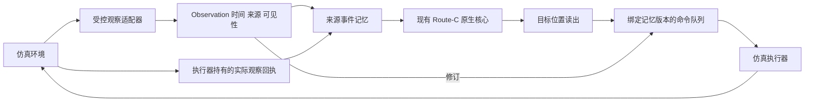

# CPSWM 仿真框架

本入口落实 2026-10-16 小规模仿真任务书及用户 2026-10-17 的“先搭框架、仿真运行、不上真机”要求。
首版提供可运行的观察、记忆、决策、执行、反馈主循环。现有 Route-C 原生联合核心和因子化对照实际参与运行，默认生产入口、完整研究范围和冻结科研参数不改。

## 快速运行

在本分支工作目录使用 Python 3.13 独立环境：

```bash
uv sync --frozen --extra dev --inexact
uv pip install --python .venv/bin/python -r requirements/small-sim.txt
.venv/bin/python tools/run_small_sim.py --backend event --output /tmp/cpswm-event-run1
.venv/bin/python tools/run_small_sim.py --backend mujoco --output /tmp/cpswm-physics-run1
.venv/bin/python tools/run_small_sim.py --backend mujoco --arms native_joint --conditions delayed_attribution execution_failure --video --output /tmp/cpswm-video-run1
```

每次输出目录必须是新目录，已有结果不会覆盖。`event` 不需要安装物理/渲染依赖；`mujoco` 需要 `requirements/small-sim.txt`。Mac 的离屏渲染需要可用的 CoreGraphics 会话；受限容器可以先运行无 `--video` 的物理积分。Linux 通常需要可用的 EGL/OpenGL 渲染环境。

首轮下载的仿真依赖不包含π0.5、SAM或LIBERO训练数据。不需要真机、机器人通信服务或付费GPU。

## 接口与执行



- `contracts.py`：事件发生时间和证据可用时间分开；observed、predicted、lost分开；来源去重、事件修订及命令/反馈合同。
- `memory.py`：适配现有 `CurrentEventRuntime`，保留24粒子、完整状态及三个RB块；延迟修订通过适配器按事件顺序重放。不是重新实现一个同名CPSWM核心。
- `runner.py`：策略只接收公开观察；迟到修订取消未执行命令；目标必须通过检查确认；失败可重试一次；执行反馈写入失败时保留回执，重试不重复执行物理动作。
- `world.py`：同一接口下的事件环境与实际MuJoCo动力学。反馈需匹配执行器持有的原始回执；内部自洽但伪造的成功结果也拒绝。
- `scenarios.py`：稳定、遮挡移动、身份纠正、迟到归因、习惯变化、执行失败六个工程联调夹具。

机器人自己执行的放置更新当前位置，不作为“主人习惯”的新观察。issued命令不等于succeeded；观察不到最终位置返回unknown。已发出的物理动作不能被追溯取消，目前仅支持派发前取消及执行完成后的纠错，不声称动作进行中的抢占能力。

## 当前后端的证据边界

| 项目 | 本版实际内容 | 尚未覆盖 |
|---|---|---|
| 事件环境 | 离散位置变化、查询成本、失败与反馈 | 物理控制能力 |
| MuJoCo | 二维执行器驱动物体、真实数值积分、状态轨迹与录像 | 机械臂抓取、接触规划、LIBERO的OSC_POSE |
| 感知 | 显式标注的受控语义传感器，可见区域查询 | RGB-D自然识别、SAM 2跟踪、自然人物归因 |
| 记忆 | 现有原生核心、来源重放、匹配因子化与普通记忆 | 默认生产完整迁移、全局原生撤回事务验收 |
| 策略 | 原生放回读出及相同检查预算；当前位置来自观察 | π0.5、联合后验驱动的主动查证 |
| 评测 | 六个可重复工程案例，保留普通记忆失败 | 240条独立序列、训练/留出划分、科学收益 |

MuJoCo红色物体是受控二维执行体，不是机械臂。观察从模拟状态经明确的受控传感器生成；这不满足自然视觉比较的真值隔离要求。评价目标仅在运行结束后评分，不输入决策器。

四个方法为 `ordinary_memory`、`source_replay`、`native_joint`、`native_factorized`。普通记忆接收但不应用历史修订；重放基线能够纠正历史。两个原生方法使用现有完整联合/匹配因子化实现。所有方法获得相同输入、位置目录、最多3次检查和2次执行机会。计算开销另外记录，不声称所有方法等算力。

本版使用公开的工程夹具读出：每个位置初始质量1，加上该位置的主人概率乘目标身份概率；原生核心消费同一基础分布。这是适配器联调设定，不是冻结v06正式比较协议，也不代表用户选择了新的科研先验。正式实验需接回已批准的读出及原生事件生产链。核心内部的七算子回执存在不等于七算子均执行或产生收益；日志分别记录出现与执行次数。

`seed`目前仅生成确定事件身份，不产生独立世界动力学。不要通过更换seed将六个夹具包装为更多独立实验。人物/身份纠正均为受控输入，未展示自然多人能力；完整研究范围继续保留。

## 日志与复现

根目录包含 `manifest.json` 和 `summary.json`；每个条件/方法有独立目录，包含 `run.json`、MuJoCo的 `scene.xml` / `trajectory.json`，以及可选 `simulation.mp4`。
文件名包含条件和方法，各episode独立目录，不复用官方示例会覆盖同名录像的命名方式。
清单记录实际代码SHA、工作树状态、源文件/模型配置哈希、环境包版本与平台。失败保存 `failure.json` 并返回非零，不生成成功summary。

```bash
.venv/bin/python -m pytest tests/test_small_sim_framework.py
.venv/bin/ruff check src/cpswm/simulation tests/test_small_sim_framework.py tools/run_small_sim.py
.venv/bin/mypy src/cpswm/simulation --follow-imports=silent
```

回执校验只覆盖本进程内的对象合同与执行器持有记录，不构成跨进程恶意代码防护。内存恢复目前针对同进程临时写入失败；进程崩溃后的持久事务恢复尚未实现。

## 后续接入顺序

1. 保留本框架作为快速回归，将物理后端替换为LIBERO原始三任务，冻结π0.5，先验证官方动作/图像/状态预处理。上游openpi已核查HEAD `215abfb217dbac7d5f1273282331b9b1866c0479`，LIBERO为 `8f1084e3132a39270c3a13ebe37270a43ece2a01`；实际部署应采用openpi锁定的子模块版本，不用两个HEAD随意组合。
2. 接SAM 2与现有光流的观察适配器，将受控来源明确替换为真实图像来源，并核对丢失、重现、因果时间和身份不确定性。
3. 按任务书细化240条事件链、独立划分、参考后验与强基线；此后再报告科学比较，不以本版夹具成功替代。

上述步骤均保持仿真范围。LIBERO/π0.5尚未在本版安装或运行，不能从这里的MuJoCo结果推出它们已经接通。
